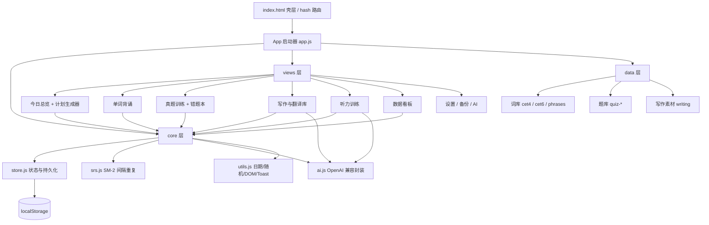

## 产品概述

「四六级英语工作台」是一名大一新生自用的**纯本地离线英语备考工作台**。目标为 2026 年 12 月首次参加大学英语四级（CET-4）考试，因此需要一套能支撑短期高强度冲刺、又能持续用一整年的个人学习工具。产品形态为**零依赖本地网页**：双击 `index.html` 即可运行，无需安装 Node.js 或任何环境，可整目录拷进 U 盘随身携带，完全离线可用。

## 核心功能（六大模块）

1. **单词背诵系统**：内置四级/六级核心词库（含音标、词性、释义、例句与例句翻译），按艾宾浩斯遗忘曲线（SM-2 间隔重复算法）安排复习；支持"认识/模糊/不认识"三档反馈、拼写填空与四选一两种自测模式；支持标星生词本与按标签筛选。
2. **真题训练与错题本**：选词填空、长篇匹配、仔细阅读三类题型练习，采用自编模拟题并提供标准 JSON 导入格式供自行扩充；答题即时判分并展示解析，错题自动入册，按题型归类，到期再练（同样走复习曲线）。
3. **写作与翻译库**：内置作文模板、万能句型、高级替换词、翻译常见句式四类素材，支持自建/编辑/删除素材与标签检索，所有自建内容存本地。
4. **每日计划生成器**：输入考试日期与每日可用时长，自动生成"单词新学 N 个 + 复习 N 个 + 阅读 1 篇 + 听力 1 段"的每日任务清单，显示考试倒计时，完成即打卡。
5. **学习数据看板**：连续打卡天数、每日学习时长、单词掌握率曲线、各模块正确率统计（原生 Canvas 手绘折线图/环形图/柱状热力图），无外部图表库。
6. **听力训练**：导入本地音频文件（仅本地读取，不上传），配合听写填空文本做精听练习，支持逐句暂停、倍速、听写答案校验与进度保存。

## 增强能力（可选、可降级）

- 设置页可填写 AI 服务的 Base URL / API Key / Model（兼容 OpenAI Chat Completions 格式，如 DeepSeek、智谱、通义等），用于**作文批改、生成例句、解析长难句**。
- 未填写密钥时相关按钮置灰并给出提示，其余五大模块**完全离线正常运行**。
- 界面明确提示：密钥仅保存在本机浏览器，前端直连会暴露给 API 服务商，仅供个人自用。

## 已确认的关键约束

- 目标：四级为主（2026 年 12 月），兼顾六级扩展。
- 形态：纯 HTML + CSS + JS，无构建工具、无 CDN、无外部依赖。
- 数据：localStorage 本地存储 + 词库内置开箱即用，另提供一键导出/导入 JSON 备份防止清缓存丢数据。
- 版权：不收录官方真题，采用自编模拟题 + 结构化导入格式。

## 技术栈选型

| 层面 | 选型 | 理由 |
| --- | --- | --- |
| 结构 | HTML5（单页 + hash 路由） | 双击 `file://` 直接打开，无需服务器 |
| 样式 | 原生 CSS3（CSS 变量设计 token + Grid/Flex） | 零依赖，主题切换只换变量，性能好 |
| 逻辑 | 原生 JavaScript（ES2019 语法，**不使用 ES Module**） | `file://` 协议下 `type="module"` 会被 CORS 拦截报错，必须用传统 script 标签 + 全局命名空间挂载 |
| 存储 | localStorage（JSON 序列化 + schema 版本号） | `file://` 下 Chrome/Edge/Firefox 均可用；封装容错与容量保护 |
| 图表 | 原生 Canvas 2D 手绘 | 不引 CDN，离线可用，体积为零 |
| 图标 | 内联 SVG 符号 | 不引字体图标库 |
| AI | fetch 直连 OpenAI 兼容接口 | 可填任意兼容服务，无 Key 自动降级 |


**明确排除**：React/Vue、打包器、npm 依赖、外部 CDN、后端与数据库。理由：用户是大一新生，双击即用、零安装、易读易改是第一优先级。

## 实现方案

### 核心策略

采用**"全局命名空间 + 单页 hash 路由 + 视图注册表"**的轻量架构：`index.html` 壳层负责侧边导航与主题切换，各 JS 文件按 `window.App.模块` 挂载，`app.js` 启动时注册路由与视图并统一初始化。所有持久化走唯一的 `Store` 层，所有跨模块共享能力（日期、Toast、DOM 助手、SRS 算法、AI 封装）下沉到 `core/`。

### 关键技术决策与权衡

1. **不用 ES Module（必须）**
`file://` 下 `<script type="module">` 触发 CORS 失败。全部用普通 script 标签按顺序加载，通过 `window.App.Store`、`window.App.SRS` 等命名空间互相调用。代价是依赖顺序需人工维护 —— 用 `index.html` 中固定的加载顺序 + 每个文件顶部注释声明依赖来兜底。

2. **存储统一入口 + 防抖写入**
localStorage 同步读写会阻塞主线程。做法：内存态 `state` 常驻，任何变更调用 `Store.commit()` 打脏标记，用 300ms 防抖批量落盘；页面 `visibilitychange`/`beforeunload` 时强制 flush。避免高频答题场景下的卡顿。

3. **复习算法用简化 SM-2 而非原始艾宾浩斯**
原始艾宾浩斯是固定间隔（1/2/4/7/15 天），无法根据个人掌握程度自适应。SM-2 保留 `ease（难度系数）`、`interval（间隔）`、`reps（连续正确次数）`，反馈"模糊/不认识"时重置间隔并降低 ease，实测更适合长期背词。间隔序列：0 → 1 → 2 → 4 → 7 → 15 → 30 → 60 天。

4. **词库分批为独立 JS 数据文件**
4500 词一次性塞进单文件会导致首屏解析卡顿且难以维护。按每文件 200–300 词拆分（CET-4 高频约 800 词分 3 批、CET-6 约 300 词 1 批），按需加载或启动即注册；同时提供 CSV/JSON 导入接口，用户可自行扩充到完整词表。

5. **图表手绘 + 脏检查重绘**
Canvas 图表只在数据变更或窗口 resize（防抖 150ms）时重绘，避免每帧开销；DPR 适配保证高分屏不模糊。

6. **AI 严格隔离在 `core/ai.js`**
唯一出口函数带"无 Key 直接返回降级对象"分支，视图层只判断返回值状态。这样即使 AI 服务不可用，也不会影响任何离线功能。Key 存 localStorage 并在设置页做掩码显示。

7. **性能与数据量**
单词量级最高约 5000 条，localStorage 约占用 1–3 MB，远低于 5 MB 上限，全量载入内存完全可行，无需分页或索引。答题与背词均为 O(1) 随机取样；到期复习队列在每日首次进入时计算一次并缓存，复杂度 O(n)。

## 实施要点（防止返工的执行细节）

- **`index.html` 中的 script 加载顺序必须固定**：`utils → store → srs → ai → router → data/* → views/* → app`，每个文件顶部用注释写明依赖，避免"未定义"报错。
- **Store 必须做 schema 版本迁移**：`settings.schemaVersion` 自增时执行迁移函数，旧备份导入时自动补齐缺失字段，防止用户升级后白屏。
- **XSS 与转义**：所有用户自建素材（写作模板、导入题目）渲染前必须经 `Utils.escapeHtml()`，不得直接 `innerHTML` 拼接。
- **导出/导入备份要做 try/catch + 格式校验**：导入失败给出明确中文提示并保留原数据，绝不静默覆盖。
- **localStorage 写入失败（隐私模式/配额满）要降级为内存态 + 顶部横幅告警**，不能让应用崩溃。
- **音频只读取本地 File 对象，用 `URL.createObjectURL` 播放，页面卸载时 `revokeObjectURL` 释放**，不在 localStorage 存音频本体（会瞬间撑爆配额），只存文件名与文本。
- **AI 请求必须带超时（AbortController，30s）与错误分类提示**（网络失败 / 401 密钥错误 / 429 限流），不得把原始报文直接弹给用户。
- **所有日期使用本地日期字符串 `YYYY-MM-DD` 作 key**，不要用 `toISOString()`（会因时区偏移导致打卡日期错乱）。

## 架构设计



数据流：用户操作 → 视图调用 `Store.commit()` 修改内存 state → 防抖落盘 localStorage → 触发订阅回调局部重渲染（不做全量重绘）。

## 目录结构

全新项目，全部文件为新建。整体遵循"core 通用能力 / data 纯数据 / views 业务视图"三层分离，命名直白，便于大一学生阅读修改。

```
e:/四六级英语工作台/
├── index.html                  # [NEW] 唯一入口。顶部栏 + 左侧导航 + 主内容区容器，按固定顺序引入所有 script，内联 SVG 图标符号表。
├── README.md                   # [NEW] 使用说明：如何双击打开、如何备份数据、如何导入自己的词库/题目、如何配置 AI、常见问题。
├── css/
│   ├── main.css                # [NEW] 设计 token（颜色/圆角/阴影/间距）、浅色与深色双主题、整体布局与侧边导航、响应式断点、通用组件样式（卡片/按钮/徽章/进度条/模态框）。
│   └── views.css               # [NEW] 各业务视图专属样式：单词卡片翻转、答题选项态、图表容器、听写填空下划线、素材卡片瀑布流。
├── js/
│   ├── app.js                  # [NEW] 启动入口：初始化 Store、注册路由与视图、绑定全局事件、首屏渲染、主题应用、版本迁移触发。
│   ├── core/
│   │   ├── utils.js            # [NEW] 本地日期格式化与日期差、数组随机与洗牌、防抖节流、escapeHtml、DOM 创建助手、Toast 提示、模态框。
│   │   ├── store.js            # [NEW] 全局状态容器 + localStorage 持久化：get/set/commit、防抖落盘、schema 版本迁移、导出 JSON、导入 JSON、订阅通知。
│   │   ├── srs.js              # [NEW] SM-2 间隔重复算法：gradeWord(word, quality) 返回新 interval/ease/due；getDueQueue() 取到期队列；掌握率统计。
│   │   ├── ai.js               # [NEW] OpenAI 兼容接口封装：isEnabled()、correctEssay()、generateExample()、analyzeSentence()，含 30s 超时、错误分类、无 Key 降级。
│   │   └── router.js           # [NEW] hash 路由：注册 #/today #/words #/quiz #/writing #/listen #/stats #/settings，切换时挂载/卸载视图并销毁定时器。
│   ├── data/
│   │   ├── cet4-words-1.js     # [NEW] 四级高频核心词第 1 批（约 250 词：word/phonetic/pos/meaning/example/exampleCn）。
│   │   ├── cet4-words-2.js     # [NEW] 四级高频核心词第 2 批（约 250 词）。
│   │   ├── cet4-words-3.js     # [NEW] 四级高频核心词第 3 批（约 250 词）。
│   │   ├── cet6-words-1.js     # [NEW] 六级高频词（约 300 词，学有余力扩展）。
│   │   ├── phrases.js          # [NEW] 高频短语与固定搭配（约 100 条）。
│   │   ├── quiz-select-fill.js # [NEW] 选词填空自编模拟题（约 8 篇，含选项、答案、解析）。
│   │   ├── quiz-matching.js    # [NEW] 长篇阅读匹配自编模拟题（约 6 篇）。
│   │   ├── quiz-reading.js     # [NEW] 仔细阅读自编模拟题（约 8 篇）。
│   │   └── writing.js          # [NEW] 写作与翻译素材：作文模板、万能句型、高级替换词、翻译常见句式四类。
│   └── views/
│       ├── today.js            # [NEW] 今日总览：考试倒计时、今日任务清单（由计划生成器算出）、一键打卡、快捷进入各模块。
│       ├── words.js            # [NEW] 单词背诵：卡片正反翻面、三档反馈、到期复习队列、拼写填空与四选一自测、生词本与筛选。
│       ├── quiz.js             # [NEW] 真题训练：题型选择、文章与题目渲染、即时判分、解析展示、进度与结果页。
│       ├── wrongbook.js        # [NEW] 错题本：按题型归类、到期重练、移除与统计。
│       ├── writing.js          # [NEW] 写作与翻译库：分类浏览、标签检索、自建素材增删改、AI 批改/例句生成/长难句解析入口。
│       ├── listen.js           # [NEW] 听力训练：音频导入、波形区播放控制、倍速与逐句、听写填空校验、进度保存。
│       ├── stats.js            # [NEW] 数据看板：Canvas 手绘连续打卡热力图、掌握率折线图、各模块正确率环形图。
│       └── settings.js         # [NEW] 设置：考试日期、每日时长、每日新词量、主题切换、AI 配置、导出/导入备份、清空数据。
└── docs/
    └── 方案说明.md              # [NEW] 本方案的落地文档：架构说明、数据模型字典、导入格式规范、常见问题。
```

## 关键代码结构

统一数据模型（存于 `Store.state`，均由 `store.js` 定义默认值与迁移）：

```javascript
// 单词（静态部分来自 data/*，学习进度部分持久化到 localStorage）
// { id, word, phonetic, pos, meaning, example, exampleCn,
//   level: 'cet4' | 'cet6', tags: [], starred: false,
//   srs: { ease: 2.5, interval: 0, reps: 0, lapses: 0, due: 'YYYY-MM-DD' },
//   status: 'new' | 'learning' | 'mastered' }

// 题目
// { id, type: 'select-fill' | 'matching' | 'reading',
//   passage: '', subQuestions: [ { id, stem, options: [], answer, explanation } ],
//   source: 'builtin' | 'custom' }

// 错题
// { questionId, type, wrongCount, lastWrongAt, nextReviewAt, userAnswer }

// 每日记录（按日期字符串为 key）
// { date: 'YYYY-MM-DD', minutes, wordsNew, wordsReviewed,
//   quizDone, quizCorrect, planDone: [], checked: false }

// 设置
// { schemaVersion, theme: 'light'|'dark', examDate, dailyMinutes, dailyNewWords,
//   ai: { baseUrl, apiKey, model } }
```

SM-2 核心接口（`js/core/srs.js` 对外契约）：

```javascript
// quality: 0=不认识 1=模糊 2=认识
// 返回新的 srs 对象 { ease, interval, reps, lapses, due }
App.SRS.gradeWord(srs, quality);

// 从全部单词中筛出 due 小于等于今天的条目，按逾期天数降序
App.SRS.getDueQueue(words, today);

// 统计各状态数量，供数据看板使用
App.SRS.getMasteryStats(words);
```

## 页面规划（6 屏，桌面端为主）

1. **今日总览**（默认页）：顶部考试倒计时卡 + 今日任务清单（计划生成器产出）+ 打卡按钮 + 六大模块快捷入口宫格。
2. **单词背诵**：中央单词卡片，下方三档反馈按钮，右侧今日进度与生词本，顶部模式切换（学习/拼写/选择）。
3. **真题训练**：左侧题型与套题列表，右侧文章与题目区，底部即时判分与解析折叠面板；页内 Tab 切换至错题本。
4. **写作与翻译库**：顶部四分类标签（模板/句型/替换词/翻译），中部卡片瀑布流，右侧素材详情与 AI 增强操作区。
5. **听力训练**：顶部音频导入与播放控制条，中部听写填空文本区，右侧答案校验与精听笔记。
6. **数据看板**：四张统计卡（连续天数/累计时长/掌握单词/平均正确率）+ 打卡热力图 + 掌握率折线图 + 各模块正确率环形图；设置以右侧抽屉形式承载（考试日期、AI 配置、备份）。

## 设计风格

**通透玻璃拟态 + 靛青渐变 + 深浅双主题**。全局使用低饱和冷灰底衬托主体内容，主色采用靛蓝到青的渐变贯穿顶部栏、进度条与关键按钮，营造专注而不压抑的学习氛围。卡片使用 1px 半透明描边加柔和弥散阴影，重要数据卡带一层极淡的渐变光晕。深浅主题一键切换，深色模式采用深靛蓝底而非纯黑，降低夜间用眼疲劳。

## 交互与动效

- 单词卡片点击做 3D 翻面（0.35s），反馈按钮按下有缩放与颜色反馈，答错时卡片轻微左右抖动。
- 导航切换采用内容区淡入上移（0.2s），不做整页刷新感。
- 进度条、环形图数值带数字滚动动画；打卡成功时图标弹跳并触发一次轻量粒子高亮。
- 所有 hover 态统一为轻微上浮加阴影加深，键盘 Tab 焦点有清晰的描边可见，支持常用快捷键（空格翻卡、1/2/3 反馈）。

## 布局与响应式

桌面端固定左侧 220px 导航 + 右侧自适应内容区（最大宽度 1200px 居中）；窗口宽度小于 1024px 时导航收起为顶部抽屉；小于 768px 时内容单列堆叠。统计卡与素材卡使用 CSS Grid 自适应列数，保证任何窗口尺寸下不出现横向滚动。