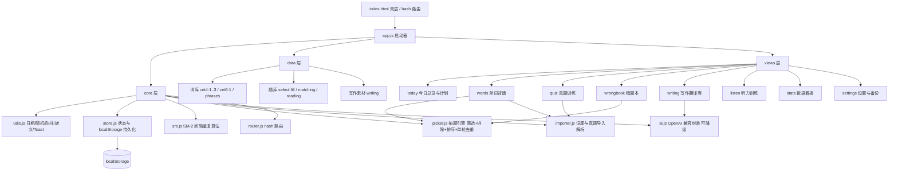

## 产品概述

「四六级英语工作台」是一名大一新生自用的**纯本地离线英语备考工作台**，目标为 2026 年 12 月首次参加大学英语四级（CET-4）。形态为**零依赖本地网页**：双击 `index.html` 即可运行，不需要安装任何环境，整个目录可拷进 U 盘随身携带，完全离线可用。

## 核心功能（六大模块）

1. **单词背诵系统**：内置四级/六级词库（含音标、词性、释义、例句与例句翻译），按简化 SM-2 间隔重复算法安排复习；支持"认识/模糊/不认识"三档反馈、拼写填空与四选一两种自测模式；支持生词本标星。
2. **真题训练与错题本**：选词填空、长篇匹配、仔细阅读三类题型。内置完全原创的仿真题开箱即用，同时提供 JSON/CSV 导入模板与粘贴入口，用户可把自行购买的真题录入系统，自动判分、自动收错题、按题型归类并排复习。
3. **写作与翻译库**：作文模板、万能句型、高级替换词、翻译常见句式四类素材，支持自建/编辑/删除与标签检索。
4. **每日计划生成器**：输入考试日期与每日可用时长，自动生成每日任务清单，显示考试倒计时，完成即打卡。
5. **学习数据看板**：连续打卡天数、每日学习时长、单词掌握率曲线、各模块正确率统计（原生 Canvas 手绘）。
6. **听力训练**：导入本地音频文件（仅本地读取不上传），配合听写填空文本做精听练习，支持倍速、逐句、答案校验与进度保存。

## 本轮重点落实的四项增强

1. **单词分层（freq 主维度 + stage 次维度）**

- `freq`（high/mid/low，考试出现频率）为**默认排序与主筛选维度**，实现"高频优先背"。
- `stage`（hs 高中课标内 / beyond 高中外增量）为**可选次要筛选器**，想只背高中外增量词时勾选即可。
- 两个字段互相独立、可自由组合。

2. **自测可选性**：抽题前提供筛选器面板，可按词书、频率、学段、学习状态、生词本、范围（今日新词/到期复习/自定义 N 词）组合圈定范围，并实时显示"本次命中 N 词"。
3. **不重复机制**：标记为"已掌握"的词**自动退出抽题池**（除非手动开启巩固模式）；同一次练习轮次内绝不重复抽到同一个词，抽完一轮才重排下一轮。
4. **掌握标记**：单词卡片右上角提供"标为已掌握"按钮，已掌握词显示绿色徽章，可在已掌握列表中查看并批量取消；自动掌握规则为连续多次正确且间隔达到阈值。
5. **题库合规方案**：内置原创仿真题（标注 `source:'builtin'`），配套真题导入模板（导入后标注 `source:'custom'` 并记录年份与套次，如"2024-06 第 1 套"）。

## 已确认的关键约束

- 目标：四级为主（2026 年 12 月），兼顾六级扩展。
- 形态：纯 HTML + CSS + JS，无构建工具、无 CDN、无外部依赖。
- 数据：localStorage 本地存储 + 词库内置开箱即用，另提供一键导出/导入 JSON 备份防止清缓存丢数据。
- 版权：不收录官方真题原文，采用原创仿真题 + 用户自行录入真题。
- AI：可选可降级，无 Key 时其余功能完全离线正常运行。

## 技术栈选型

| 层面 | 选型 | 理由 |
| --- | --- | --- |
| 结构 | HTML5（单页 + hash 路由） | 双击 `file://` 直接打开，无需服务器 |
| 样式 | 原生 CSS3（CSS 变量设计 token + Grid/Flex） | 零依赖，主题切换只换变量，性能好 |
| 逻辑 | 原生 JavaScript（ES2019，**不使用 ES Module**） | `file://` 下 `type="module"` 会被 CORS 拦截报错，必须用传统 script 标签 + 全局命名空间挂载 |
| 存储 | localStorage（JSON 序列化 + schema 版本号） | `file://` 下 Chrome/Edge/Firefox 均可用 |
| 图表 | 原生 Canvas 2D 手绘 | 不引图表库，离线可用，体积为零 |
| 图标 | 内联 SVG 符号表 | 不引字体图标库 |
| AI | fetch 直连 OpenAI 兼容接口 | 可填任意兼容服务，无 Key 自动降级 |


**明确排除**：React/Vue、打包器、npm 依赖、外部 CDN（含 Tailwind CDN）、后端与数据库。用户是大一新生，双击即用、零安装、易读易改是第一优先级；引入 CDN 会破坏"完全离线"这一首要约束，因此即使架构指南建议 Tailwind CDN 也不采用，改由原生 CSS 变量实现同等的设计 token 与视觉效果。

## 实现方案

### 核心策略

采用**"全局命名空间 + 单页 hash 路由 + 视图注册表"**的轻量架构。`index.html` 壳层负责侧边导航与主题切换，各 JS 文件按 `window.App.模块` 挂载，`app.js` 启动时注册路由与视图。所有持久化走唯一的 `Store` 层，所有跨模块共享能力（日期、Toast、DOM 助手、SRS 算法、抽题引擎、导入解析、AI 封装）下沉到 `core/`，业务视图只做渲染与事件绑定。

### 关键技术决策与权衡

1. **不用 ES Module（硬性）**
`file://` 下 ES Module 触发 CORS 失败。全部普通 script 标签按固定顺序加载，通过 `window.App.Store`、`window.App.Picker` 等命名空间互相调用。代价是依赖顺序需人工维护——用 `index.html` 中固定加载顺序 + 每个文件顶部注释声明依赖来兜底。

2. **抽题引擎独立成 `core/picker.js`（本轮新增核心）**
筛选逻辑（词书 / 频率 / 学段 / 状态 / 生词本 / 范围）、排除逻辑（已掌握剔除）、排序逻辑（频率权重 → 逾期天数 → 久未见优先）、去重逻辑（单轮 session Set）集中在单一模块。单词视图与错题本视图共用同一引擎，避免两处各写一套筛选导致行为不一致。

3. **频率与学段拆成两个独立字段（需求调和）**
用户既要"不分学段按频率背"，又要"能按高中/高中外筛选"。若只留一个字段二者互斥，故设计为 `freq`（主维度，默认降序排序与默认勾选 high）+ `stage`（可勾选的次要过滤器）。默认行为满足"高频优先"，想切到"只背高中外增量"勾选 `stage:['beyond']` 即可，互不干扰。

4. **已掌握用独立布尔字段而非仅靠 status**
`status` 由算法自动推导（new/learning/mastered），`mastered` 由用户手动标记。两者分离，避免用户手动取消标记时被算法状态覆盖。抽题池排除条件为 `mastered === true && !consolidate`。

5. **单轮去重用 session 对象而非全局黑名单**
进入练习时 `Picker.createSession(pool)` 生成 session，内部维护 `usedIds` Set 与剩余队列；`next()` 永不返回本轮已出词，队列抽空自动重排新一轮并清空 Set。避免"7 天冷却"这类全局黑名单带来的词荒问题（池子小的时候会没有词可练）。

6. **复习算法用简化 SM-2 而非原始艾宾浩斯**
原始艾宾浩斯是固定间隔无法自适应。SM-2 保留 `ease`/`interval`/`reps`/`lapses`，反馈"模糊/不认识"时重置间隔并降低 ease。间隔序列：0 → 1 → 2 → 4 → 7 → 15 → 30 → 60 天。

7. **词库分批为独立 JS 数据文件**
一次性塞进单文件会首屏卡顿且难维护。按每文件 200–300 词拆分，同时提供 CSV 导入接口供用户扩充到完整 4500 词。

8. **存储统一入口 + 防抖写入**
内存态 `state` 常驻，任何变更调用 `Store.commit()` 打脏标记，300ms 防抖批量落盘；`visibilitychange`/`beforeunload` 强制 flush。避免高频答题场景卡顿。

9. **AI 严格隔离在 `core/ai.js`**
唯一出口函数带"无 Key 直接返回降级对象"分支，视图层只判断返回值状态。即使 AI 服务不可用也不影响任何离线功能。

10. **复杂度与性能**
单词量级最高约 5000 条，localStorage 占用约 1–3 MB，远低于 5 MB 上限，全量载入内存可行，无需分页或索引。构建抽题池为一次 O(n) 遍历并缓存（依赖 `freq`/`stage`/`status`/`mastered` 的复合 key），池内取词 O(1)；到期复习队列每日首次进入计算一次 O(n)。Canvas 图表仅在数据变更或窗口 resize（防抖 150ms）时重绘，并做 DPR 适配。

## 实施要点（防止返工的执行细节）

- **`index.html` 中 script 加载顺序必须固定**：`utils → store → srs → picker → importer → ai → router → data/* → views/* → app`，每个文件顶部用注释写明依赖。
- **Store 必须做 schema 版本迁移**：`settings.schemaVersion` 自增时执行迁移函数，旧备份导入自动补齐缺失字段（尤其是本轮新增的 `freq`/`stage`/`mastered`），防止升级后白屏。
- **抽题池缓存 key 必须包含所有筛选维度与 `mastered` 变更计数**，否则用户标记掌握后池子不刷新。
- **XSS 与转义**：用户录入的真题、自建素材、导入词库渲染前必须经 `Utils.escapeHtml()`，不得直接 `innerHTML` 拼接。
- **导入必须做字段校验 + 逐行错误报告**：解析失败的行给出行号与原因，成功部分正常入库，失败部分原样保留在文本框，绝不静默丢弃或覆盖已有数据。
- **导入去重**：词库按 `word + pos` 归一化去重，题库按 `id` 去重；重复项提示"已存在 N 条，已跳过"。
- **localStorage 写入失败（隐私模式/配额满）降级为内存态 + 顶部横幅告警**，不能让应用崩溃。
- **音频只读取本地 File 对象**，用 `URL.createObjectURL` 播放，页面卸载时 `revokeObjectURL` 释放；localStorage 只存文件名与文本，绝不存音频本体（会瞬间撑爆配额）。
- **AI 请求必须带 AbortController 30s 超时与错误分类提示**（网络失败 / 401 密钥错误 / 429 限流），不得把原始报文直接弹给用户。
- **所有日期使用本地日期字符串 `YYYY-MM-DD` 作 key**，禁用 `toISOString()`（时区偏移会导致打卡日期错乱）。
- **空池兜底**：筛选后命中 0 词时，UI 明确提示是哪个维度导致的，并提供"重置筛选"与"开启巩固模式"两个一键入口，不能显示空白页。

## 架构设计



数据流：用户操作 → 视图调用 `Picker.buildPool()` 取词 / `Store.commit()` 改状态 → 内存 state 更新 → 300ms 防抖落盘 → 订阅回调触发局部重渲染（不做全量重绘）。

## 目录结构

全新项目，全部文件为新建。遵循"core 通用能力 / data 纯数据 / views 业务视图"三层分离，命名直白，便于初学者阅读修改。

```
e:/四六级英语工作台/
├── index.html                  # [NEW] 唯一入口。顶部栏 + 左侧导航 + 主内容区容器，固定顺序引入所有 script，内联 SVG 图标符号表。
├── README.md                   # [NEW] 使用说明：如何双击打开、如何备份、如何导入词库与真题、如何配置 AI、常见问题。
├── css/
│   ├── main.css                # [NEW] 设计 token（颜色/圆角/阴影/间距）、浅色与深色双主题、整体布局与侧边导航、响应式断点、通用组件（卡片/按钮/徽章/进度条/模态框/筛选器）。
│   └── views.css               # [NEW] 各业务视图专属样式：单词卡片 3D 翻面、答题选项态、图表容器、听写填空下划线、素材卡片瀑布流、掌握徽章。
├── js/
│   ├── app.js                  # [NEW] 启动入口：初始化 Store、注册路由与视图、绑定全局事件、首屏渲染、主题应用、版本迁移触发。
│   ├── core/
│   │   ├── utils.js            # [NEW] 本地日期格式化与日期差、数组随机与洗牌、防抖节流、escapeHtml、DOM 创建助手、Toast、模态框。
│   │   ├── store.js            # [NEW] 全局状态容器 + localStorage 持久化：get/set/commit、300ms 防抖落盘、schema 版本迁移、导出 JSON、导入 JSON、订阅通知、写入失败降级。
│   │   ├── srs.js              # [NEW] SM-2 间隔重复算法：gradeWord/getDueQueue/getMasteryStats，间隔序列 0/1/2/4/7/15/30/60 天。
│   │   ├── picker.js           # [NEW] 抽题引擎：buildPool 组合筛选（词书/频率/学段/状态/生词本/范围）、已掌握排除、优先级排序、createSession 单轮去重、池缓存与失效。
│   │   ├── importer.js         # [NEW] 导入解析：CSV 与 JSON 两种格式，字段校验、归一化去重、逐行错误报告、合并入库。
│   │   ├── ai.js               # [NEW] OpenAI 兼容接口封装：isEnabled/correctEssay/generateExample/analyzeSentence，30s 超时、错误分类、无 Key 降级。
│   │   └── router.js           # [NEW] hash 路由：注册 #/today #/words #/quiz #/writing #/listen #/stats #/settings，切换时挂载/卸载视图并销毁定时器。
│   ├── data/
│   │   ├── cet4-words-1.js     # [NEW] 四级词第 1 批（约 270 词），每条含 word/phonetic/pos/posTag/meaning/example/exampleCn/freq/stage。
│   │   ├── cet4-words-2.js     # [NEW] 四级词第 2 批（约 270 词）。
│   │   ├── cet4-words-3.js     # [NEW] 四级词第 3 批（约 270 词）。
│   │   ├── cet6-words-1.js     # [NEW] 六级高频词（约 300 词，学有余力扩展）。
│   │   ├── phrases.js          # [NEW] 高频短语与固定搭配（约 100 条）。
│   │   ├── quiz-select-fill.js # [NEW] 原创仿真题·选词填空（约 8 篇，含文章、选项、答案、解析）。
│   │   ├── quiz-matching.js    # [NEW] 原创仿真题·长篇阅读匹配（约 6 篇）。
│   │   ├── quiz-reading.js     # [NEW] 原创仿真题·仔细阅读（约 8 篇）。
│   │   └── writing.js          # [NEW] 写作与翻译素材：作文模板、万能句型、高级替换词、翻译常见句式四类。
│   └── views/
│       ├── today.js            # [NEW] 今日总览：考试倒计时、今日任务清单、一键打卡、六大模块快捷入口宫格。
│       ├── words.js            # [NEW] 单词背诵：筛选器面板（词书/频率/学段/状态/巩固模式/范围与数量 + 实时命中数）、卡片翻面、三档反馈、标为已掌握、拼写与选择自测、已掌握列表批量管理。
│       ├── quiz.js             # [NEW] 真题训练：题型与套题选择、内置题与导入真题统一渲染、即时判分、解析折叠面板、结果页；真题录入入口（粘贴 JSON/CSV）。
│       ├── wrongbook.js        # [NEW] 错题本：按题型归类、到期重练、移除与统计。
│       ├── writing.js          # [NEW] 写作与翻译库：四分类标签、卡片瀑布流、标签检索、自建素材增删改、AI 批改/例句生成/长难句解析入口。
│       ├── listen.js           # [NEW] 听力训练：音频导入、播放控制条、倍速与逐句、听写填空校验、进度保存。
│       ├── stats.js            # [NEW] 数据看板：Canvas 手绘打卡热力图、掌握率折线图、各模块正确率环形图、四张统计卡。
│       └── settings.js         # [NEW] 设置：考试日期、每日时长、每日新词量、主题切换、AI 配置、导入词库/真题、导出/导入备份、清空数据。
└── docs/
    ├── 方案说明.md              # [NEW] 落地文档：架构说明、数据模型字典、抽题引擎算法说明、风险与后续扩展。
    └── templates/
        ├── words-template.csv  # [NEW] 词库导入模板，含表头、两行示例与字段说明注释。
        ├── quiz-template.json  # [NEW] 真题导入模板，三种题型各一个完整示例，字段齐全。
        └── 导入说明.md          # [NEW] 手把手教程：如何把买到的真题录成 JSON、常见录入错误与排查。
```

## 关键代码结构

数据模型（存于 `Store.state`，由 `store.js` 定义默认值与迁移）：

```javascript
// 单词 —— 静态部分在 data/*，学习进度持久化到 localStorage
// { id, word, phonetic, pos, meaning, example, exampleCn,
//   level: 'cet4' | 'cet6',
//   freq:  'high' | 'mid' | 'low',   // 主筛选与排序维度：考试出现频率
//   stage: 'hs' | 'beyond',          // 次要筛选维度：是否高中课标词汇
//   posTag:'v'|'n'|'adj'|'adv'|'prep'|'conj',
//   tags: [], starred: false,
//   srs: { ease:2.5, interval:0, reps:0, lapses:0, due:'YYYY-MM-DD' },
//   status: 'new' | 'learning' | 'mastered',
//   mastered: false, masteredAt: null,   // 手动标记，控制是否退出抽题池
//   lastSeenAt: null }

// 题目 —— 内置原创仿真题与用户导入真题共用
// { id, type:'select-fill'|'matching'|'reading',
//   source:'builtin'|'custom', year:'', paper:'',
//   passage:'', subQuestions:[ {id, stem, options:[], answer, explanation} ] }

// 错题：{ questionId, type, wrongCount, lastWrongAt, nextReviewAt, userAnswer }
// 每日记录：{ date:'YYYY-MM-DD', minutes, wordsNew, wordsReviewed,
//            quizDone, quizCorrect, planDone:[], checked:false }
// 设置：{ schemaVersion, theme, examDate, dailyMinutes, dailyNewWords,
//        quizFilter:{ level, freq:[], stage:[], status:[], starredOnly, consolidate, scope, count },
//        ai:{ baseUrl, apiKey, model } }
```

抽题引擎契约（`js/core/picker.js`，本轮新增核心模块）：

```javascript
// 组合筛选构建抽题池，返回按优先级排序的词数组
App.Picker.buildPool({
  level: 'cet4' | 'cet6' | 'all',
  freq: ['high','mid','low'],          // 主维度，默认 ['high']
  stage: ['hs','beyond'],              // 次要维度，默认两者全选
  status: ['new','learning','mastered'],
  starredOnly: false,
  consolidate: false,                  // 巩固模式：开启后已掌握词重新入池
  scope: 'today-new' | 'due' | 'starred' | 'custom',
  count: 20
});
// 排除规则：mastered === true && !consolidate → 剔除
// 排序规则：freq 权重降序 → 逾期天数降序 → lastSeenAt 升序（越久没见越优先）
// 单轮去重：App.Picker.createSession(pool) 返回 session，next() 不重复，池抽空自动重排新一轮
// 空池兜底：返回 { empty: true, reason: 'freq' | 'stage' | 'status' | 'mastered' }
```

SM-2 核心接口（`js/core/srs.js` 对外契约）：

```javascript
// quality: 0=不认识 1=模糊 2=认识
// 返回新的 srs 对象 { ease, interval, reps, lapses, due }
App.SRS.gradeWord(srs, quality);

// 筛出 due 小于等于今天的条目，按逾期天数降序
App.SRS.getDueQueue(words, today);

// 统计各状态数量，供数据看板使用
App.SRS.getMasteryStats(words);
```

导入格式规范（`docs/templates/`）：

```
词库 CSV 表头：
word,phonetic,pos,meaning,example,exampleCn,level,freq,stage,posTag
（freq 取 high|mid|low，stage 取 hs|beyond，缺失时按 mid/hs 兜底并在报告中提示）

真题 JSON 结构（三种题型共用外层字段）：
{ "type": "reading", "source": "custom", "year": "2024-06", "paper": "第1套",
  "passage": "...", "subQuestions": [ { "stem":"...", "options":["A...","B..."],
  "answer":"B", "explanation":"..." } ] }
```

## 设计风格

通透玻璃拟态 + 靛青渐变 + 深浅双主题。低饱和冷灰底衬托主体内容，主色采用靛蓝到青的渐变贯穿顶部栏、进度条与关键按钮，营造专注而不压抑的学习氛围。卡片使用 1px 半透明描边加柔和弥散阴影，重要数据卡带一层极淡的渐变光晕。深色模式采用深靛蓝底而非纯黑，降低夜间用眼疲劳。

## 页面规划（桌面端为主，共 6 屏）

**1. 今日总览（默认页）**

- 顶部栏：Logo + 考试倒计时胶囊 + 主题切换 + 设置入口。
- 倒计时卡：距四级考试天数大字显示，配环形进度条展示整体备考进度。
- 今日任务清单：由计划生成器产出的任务条目（新学 N 词 / 复习 N 词 / 阅读 1 篇 / 听力 1 段），带勾选态与完成进度。
- 一键打卡按钮：居中大按钮，打卡后弹跳反馈。
- 模块宫格：六大模块快捷入口卡，每张带图标、标题、今日待办数徽章。

**2. 单词背诵**

- 左侧筛选器面板：词书下拉、频率三选（高/中/低）、学段双选（高中/高中外）、状态三选（未学/学习中/已掌握）、巩固模式开关、范围选择（今日新词/到期复习/生词本/自定义 N 词）；底部常驻显示"本次命中 N 词"。
- 中央单词卡片：正面单词与音标，背面释义、例句与例句翻译；3D 翻面；右上角"标为已掌握"星标按钮。
- 卡片底部三档反馈按钮（不认识/模糊/认识），配色分别对应红/橙/绿。
- 顶部模式切换：学习 / 拼写填空 / 四选一。
- 右侧栏：今日进度环、生词本列表、已掌握数量与"批量取消掌握"入口。

**3. 真题训练**

- 左侧栏：题型 Tab（选词填空/长篇匹配/仔细阅读）+ 套题列表，内置题与导入真题分区展示并标注来源与年份。
- 右侧主区：文章阅读区，题目与选项，答题即时判分，底部解析折叠面板。
- 顶部"录入真题"按钮：弹出粘贴框，支持 JSON/CSV，带格式校验与逐行错误提示。
- 页内 Tab 切换至错题本视图。

**4. 写作与翻译库**

- 顶部四分类标签：模板 / 句型 / 替换词 / 翻译。
- 中部素材卡片瀑布流，卡片显示标题、正文摘要、标签徽章。
- 右侧详情面板：素材全文、编辑/删除按钮、AI 增强操作区（作文批改 / 生成例句 / 长难句解析）。
- 顶部搜索框与标签筛选。

**5. 听力训练**

- 顶部音频导入与播放控制条：播放/暂停、进度条、倍速选择、逐句跳段。
- 中部听写填空文本区，挖空处为下划线输入框，支持 Tab 跳转。
- 右侧答案校验面板与精听笔记输入框，支持进度保存。

**6. 数据看板**

- 四张统计卡：连续打卡天数 / 累计学习时长 / 掌握单词数 / 平均正确率，数值带滚动动画。
- 打卡热力图：近 12 周方格矩阵，颜色深浅表示当日学习强度。
- 掌握率折线图：近 30 天掌握单词数变化曲线。
- 各模块正确率环形图：单词、阅读、听力、写作四模块对比。
- 设置以右侧抽屉形式承载（考试日期、AI 配置、导入导出备份）。

## 交互与动效

- 单词卡片点击 3D 翻面（0.35s），反馈按钮按下缩放并变色，答错时卡片轻微左右抖动。
- 标为已掌握时星标填充动画 + 绿色徽章淡入，词卡飞出抽题池的收缩过渡。
- 筛选器每次变更，命中数做数字滚动更新，抽题池为空时抖动提示并高亮冲突维度。
- 导航切换内容区淡入上移（0.2s），不做整页刷新感。
- 进度条与环形图数值滚动动画；打卡成功图标弹跳并触发轻量粒子高亮。
- 所有 hover 态统一为轻微上浮加阴影加深；键盘 Tab 焦点有清晰描边。
- 快捷键：空格翻卡，1/2/3 对应三档反馈，S 标星，M 标为已掌握。

## 布局与响应式

桌面端固定左侧 220px 导航 + 右侧自适应内容区（最大宽度 1200px 居中）；窗口宽度小于 1024px 时导航收起为顶部抽屉；小于 768px 时内容单列堆叠，筛选器面板折叠为可展开的抽屉。统计卡与素材卡使用 CSS Grid 自适应列数，保证任何窗口尺寸下不出现横向滚动。