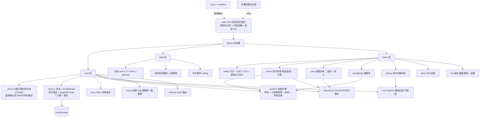

## 产品概述

「四六级英语工作台」是一名大一新生自用的**移动优先离线英语备考工具**，目标 2026 年 12 月首考大学英语四级（CET-4）。手机上打开网址、添加到主屏幕后像原生 App 一样使用，电脑上双击 `index.html` 同样可用。数据全部存在设备本地，不上传任何服务器。

## 核心功能（六大模块）

1. **单词背诵**：内置四/六级词库（音标、词性、释义、例句与译文），按 SM-2 间隔重复安排复习；支持「认识 / 模糊 / 不认识」三档反馈、拼写填空与四选一自测、滑动切词。
2. **真题训练与错题本**：选词填空、长篇匹配、仔细阅读三类题型。内置原创仿真题开箱即用，另提供录入入口，可把自行购买的真题录进系统，自动判分、自动收错题、按题型归类并排复习。
3. **写作与翻译库**：作文模板、万能句型、高级替换词、翻译句式四类素材，支持自建增删改与搜索。
4. **每日计划与打卡**：输入考试日期与每日时长，自动生成每日任务清单，显示倒计时，完成即打卡。
5. **学习数据看板**：连续打卡天数、学习时长、掌握率曲线、各模块正确率（图表）。
6. **听力训练**：导入本地音频，做听写填空与精听练习，支持倍速、逐句、答案校验。

## 单词专项要求（第二轮确认）

- **分层**：`freq` 高频/中频/低频 为主维度（默认高频优先背）；`stage` 高中课标内/高中外 为可选次要筛选器，两者独立可组合。
- **可选性**：背词前可从底部弹出筛选面板，按词书、频率、学段、学习状态、生词本、范围自由组合，实时显示「本次命中 N 词」。
- **不重复**：标记为「已掌握」的词自动退出抽题池（可开巩固模式召回）；同一次练习内绝不重复抽到同一个词。
- **掌握标记**：卡片右上角一键「标为已掌握」，已掌握词显示绿色徽章，可批量取消。

## 移动端形态（第三轮确认）

- 手机为主、电脑自动适配宽屏；部署到免费静态托管 + PWA，可添加到主屏幕离线使用。
- 底部 5 个大图标 Tab：**今日 / 单词 / 写作 / 听力 / 我的**。
- **重要取舍**：底部 Tab 只有 5 个位置，「真题训练」未被选入一级导航，因此做成「今日」页首屏的**渐变主行动卡**（带今日待办数徽章，点击直接进入），并在「我的」页提供「错题本」入口。导航配置集中在单一数组，日后想把真题提到一级 Tab 只需改一行。

## 已确认约束

- 四级为主（2026 年 12 月），兼顾六级扩展。
- 零依赖、零 CDN、无构建工具，完全离线可用。
- 数据存 localStorage，提供一键导出/导入备份防丢失。
- 不收录官方真题原文，内置题全部原创，真题由用户自行录入。
- AI 功能可选可降级，未配置密钥时其余功能完全离线正常运行。

## 技术栈选型

| 层面 | 选型 | 理由 |
| --- | --- | --- |
| 结构 | HTML5 单页 + hash 路由 | 一套代码同时跑 `file://` 与 `https://` |
| 样式 | 原生 CSS3（CSS 变量 + Grid/Flex + 媒体查询） | 零依赖，主题切换只换变量；宽屏与窄屏共用一套 DOM |
| 逻辑 | 原生 JavaScript（ES2019，**禁用 ES Module**） | `file://` 下 `type="module"` 触发 CORS 失败，必须用传统 script + `window.App.*` 命名空间 |
| 存储 | localStorage（JSON + schema 版本号） | 手机与桌面浏览器均支持，容量足够 |
| 离线 | Service Worker + Web App Manifest | 添加到主屏幕后无网络也能用 |
| 图表 | 原生 Canvas 2D 手绘 | 不引图表库，零体积，手机端性能可控 |
| 图标 | 内联 SVG 符号表 + 自生成 PNG | 不引字体图标库，无外部素材版权问题 |
| AI | fetch 直连 OpenAI 兼容接口 | 可填任意兼容服务，无 Key 自动降级 |


**明确排除**：React/Vue、打包器、npm 依赖、任何 CDN（含架构指南建议的 Tailwind CDN）、后端与数据库。理由是用户要求「离线可用 + 手机上像 App + 易读易改」，引入 CDN 会同时破坏离线能力与 PWA 缓存，改由原生 CSS 变量实现同等设计 token。

## 实现方案

### 核心策略

采用 **「全局命名空间 + hash 路由 + 视图注册表 + 移动优先 CSS」** 四件套。`index.html` 只提供壳层（顶部安全区、内容容器、底部 Tab），各 JS 按 `window.App.模块` 挂载，`app.js` 启动时注册路由与视图。所有持久化走唯一的 `Store` 层，跨模块共享能力（日期、Toast、手势、底部弹出层、SRS、抽题引擎、导入解析、AI）全部下沉到 `core/`，视图层只做渲染与事件绑定。

### 关键技术决策与权衡

1. **移动优先，宽屏用媒体查询升级而非另写一套**
设计基准为 375–430px 手机宽度，≥900px 时通过纯 CSS 把底部 Tab 变为左侧竖向导航、单词页由单列变双列。同一套 DOM 与 JS，不维护两套模板，避免双份逻辑不同步。

2. **双环境兼容：`file://` 与 `https://` 都要能跑**
Service Worker 注册用 `try/catch` 包裹，`file://` 下注册失败静默跳过、不影响任何功能；manifest 在 `file://` 下无效但不报错。这样电脑上双击照常可用，手机上部署后获得完整 PWA 能力。

3. **Service Worker 缓存策略**
静态资源（css/js/data/图标）Cache-First 预缓存，缓存名带版本号，更新时清理旧缓存；AI 请求与一切非 GET 请求 Network-Only 不缓存；导航请求 Network-Falling-Back-To-Cache。保证断网可用且不会出现「更新后还是旧页面」。

4. **抽题引擎独立成 `core/picker.js`**
筛选（词书/频率/学段/状态/生词本/范围）、排除（已掌握剔除）、排序（频率权重 → 逾期天数 → 久未见优先）、去重（单轮 session Set）集中在一个模块。单词视图与错题本共用，避免两处各写一套导致行为不一致。

5. **频率与学段拆成两个独立字段（需求调和）**
用户既要「不分学段按频率背」，又要「能按高中/高中外筛选」。只留一个字段二者互斥，故设 `freq` 为主排序维度（默认勾选 high）+ `stage` 为可勾选的次要过滤器，互不干扰。

6. **已掌握用独立布尔字段而非仅靠 status**
`status` 由算法自动推导，`mastered` 由用户手动标记。两者分离，避免用户手动取消时被算法状态覆盖。抽题池排除条件：`mastered === true && !consolidate`。

7. **单轮去重用 session 对象而非全局黑名单**
`Picker.createSession(pool)` 内部维护 `usedIds` Set 与剩余队列，`next()` 永不返回本轮已出词，队列抽空自动重排新一轮。全局「N 天冷却」在池子小时会造成无词可练，故做成默认关闭的开关。

8. **复习算法用简化 SM-2 而非原始艾宾浩斯**
原始艾宾浩斯是固定间隔无法自适应。SM-2 保留 `ease`/`interval`/`reps`/`lapses`，答错时重置间隔并降 ease。间隔序列 0 → 1 → 2 → 4 → 7 → 15 → 30 → 60 天。

9. **存储统一入口 + 防抖写入 + 移动端可靠落盘**
内存 state 常驻，变更调 `Store.commit()` 打脏标记，300ms 防抖批量落盘；**移动端用 `pagehide` + `visibilitychange` 双重强制 flush**（iOS Safari 上 `beforeunload` 不可靠，切后台会丢数据）。localStorage 写入失败时降级为内存态并顶部横幅告警，绝不崩溃。

10. **手机性能考量**
单词最多约 5000 条，localStorage 占 1–3 MB，远低于 5 MB 上限，全量载入内存可行。抽题池构建为一次 O(n) 遍历并缓存（缓存 key 必须包含所有筛选维度与 `mastered` 变更计数，否则标记掌握后池子不刷新）。Canvas 图表仅在数据变更或 resize（防抖 150ms）时重绘并做 DPR 适配。列表超过 100 项时分批渲染，避免长列表卡顿。

## 实施要点（防止返工的执行细节）

- **script 加载顺序固定**：`utils → store → srs → picker → importer → ai → nav → router → data/* → views/* → app`，每个文件顶部注释声明依赖，避免「未定义」报错。
- **移动端必做项**：`viewport` 含 `viewport-fit=cover`；底部 Tab 与浮层用 `env(safe-area-inset-bottom)` 避开 iPhone 底部横条；高度用 `100dvh` 处理地址栏伸缩；所有可点元素最小触控区 **44×44px**；`touch-action: manipulation` 防双击缩放误触但保留捏合缩放；`-webkit-tap-highlight-color: transparent`；按钮与输入框字号 ≥16px 防 iOS 聚焦缩放；`hover` 效果一律用 `@media (hover: hover)` 包裹，避免触屏上残留。
- **Store 必须做 schema 迁移**：`settings.schemaVersion` 自增时执行迁移；导入旧备份自动补齐缺失字段（尤其 `freq`/`stage`/`mastered`），防止升级后白屏。
- **XSS 与转义**：用户录入的真题、自建素材、导入词库渲染前必须经 `Utils.escapeHtml()`，禁止直接 `innerHTML` 拼接。
- **导入必须逐行校验与错误报告**：失败行给出行号与原因，成功部分正常入库，失败部分原样保留在输入框，绝不静默丢弃或覆盖已有数据。词库按 `word+pos` 去重，题库按 `id` 去重，重复项提示「已存在 N 条，已跳过」。
- **空池兜底**：筛选命中 0 词时明确提示是哪个维度导致的，并提供「重置筛选」「开启巩固模式」两个一键入口，不能显示空白页。
- **音频只读取本地 File**：用 `URL.createObjectURL` 播放，页面卸载时 `revokeObjectURL` 释放；localStorage 只存文件名与文本，绝不存音频本体（会瞬间撑爆配额）。
- **AI 请求必须带 AbortController 30s 超时与错误分类**（网络失败 / 401 密钥错误 / 429 限流），不把原始报文弹给用户；Key 存 localStorage 并掩码显示，界面提示「密钥仅存本机，前端直连会暴露给服务商，仅供个人自用」。
- **日期统一用本地日期字符串 `YYYY-MM-DD` 作 key**，禁用 `toISOString()`（时区偏移会导致打卡日期错乱）。
- **PWA 图标零依赖生成**：用 Python 标准库（zlib + struct）写一次性脚本生成 192/512/180 三张纯色渐变 PNG，脚本生成后即删除，仓库只留产物，无外部素材与版权问题。

## 架构设计



数据流：用户操作 → 视图调 `Picker.buildPool()` 取词 / `Store.commit()` 改状态 → 内存 state 更新 → 300ms 防抖落盘 → 订阅回调触发局部重渲染（不做全量重绘）。

## 目录结构

全新项目，全部文件为新建。遵循「core 通用能力 / data 纯数据 / views 业务视图」三层分离，命名直白，便于初学者阅读修改。

```
e:/四六级英语工作台/
├── index.html                  # [NEW] 唯一入口。viewport-fit=cover、manifest 与 sw 注册（try/catch）、底部 Tab 骨架、内联 SVG 符号表、固定顺序引入 script。
├── manifest.webmanifest        # [NEW] PWA 清单：名称、3 个图标、display:standalone、theme_color #4F46E5、start_url。
├── sw.js                       # [NEW] Service Worker：静态资源 Cache-First 预缓存、版本化缓存名、非 GET 与 AI 请求不拦截、file:// 下静默失效。
├── README.md                   # [NEW] 使用说明：本地双击、部署到静态托管、手机添加到主屏幕、备份、导入词库与真题、配置 AI、常见问题。
├── icons/
│   ├── icon-192.png            # [NEW] 一次性 Python 脚本生成的纯渐变 PNG，脚本生成后删除。
│   ├── icon-512.png            # [NEW] 同上，用于 PWA 安装与掩码图标。
│   ├── apple-touch-icon.png    # [NEW] 180×180，iOS 添加到主屏幕用。
│   └── favicon.svg             # [NEW] 内联渐变 SVG，浏览器标签页图标。
├── css/
│   ├── main.css                # [NEW] 设计 token、双主题变量、移动优先布局、底部 Tab（含 safe-area）、≥900px 断点下 Tab 转左侧导航、通用组件（卡片/按钮/徽章/进度条/底部弹出层/Toast/表单/开关）。
│   └── views.css               # [NEW] 各视图专属样式：单词卡 3D 翻面与滑动手势、答题选项整行大点击区、图表容器、听写填空下划线、素材卡列表、掌握徽章。
├── js/
│   ├── app.js                  # [NEW] 启动入口：初始化 Store、注册路由与视图、注册 SW、首屏渲染、主题应用、版本迁移。
│   ├── core/
│   │   ├── utils.js            # [NEW] 日期、洗牌、防抖节流、escapeHtml、DOM 助手、Toast、底部弹出层 Sheet、手势识别（tap/swipe）、navigator.vibrate 触觉反馈。
│   │   ├── store.js            # [NEW] 状态容器 + localStorage：commit / 300ms 防抖落盘 / pagehide 强制 flush / schema 迁移 / 导出导入备份 / 写入失败降级。
│   │   ├── srs.js              # [NEW] SM-2 间隔重复算法，间隔序列 0/1/2/4/7/15/30/60 天。
│   │   ├── picker.js           # [NEW] 抽题引擎：组合筛选、已掌握排除、优先级排序、单轮去重 session、池缓存与失效。
│   │   ├── importer.js         # [NEW] CSV 与 JSON 导入解析：字段校验、归一化去重、逐行错误报告、合并入库。
│   │   ├── ai.js               # [NEW] OpenAI 兼容封装：isEnabled/correctEssay/generateExample/analyzeSentence，30s 超时、错误分类、无 Key 降级。
│   │   ├── nav.js              # [NEW] 底部 Tab 配置数组（单一数据源）+ Tab 渲染与激活态管理。
│   │   └── router.js           # [NEW] hash 路由：#/today #/words #/quiz #/writing #/listen #/me，切换时挂载/卸载视图并销毁定时器。
│   ├── data/
│   │   ├── cet4-words-1.js     # [NEW] 四级词第 1 批（约 270 词），含 word/phonetic/pos/posTag/meaning/example/exampleCn/freq/stage。
│   │   ├── cet4-words-2.js     # [NEW] 四级词第 2 批（约 270 词）。
│   │   ├── cet4-words-3.js     # [NEW] 四级词第 3 批（约 270 词）。
│   │   ├── cet6-words-1.js     # [NEW] 六级高频词（约 300 词，学有余力扩展）。
│   │   ├── phrases.js          # [NEW] 高频短语与固定搭配（约 100 条）。
│   │   ├── quiz-select-fill.js # [NEW] 原创仿真题·选词填空（约 8 篇，含文章、选项、答案、解析）。
│   │   ├── quiz-matching.js    # [NEW] 原创仿真题·长篇阅读匹配（约 6 篇）。
│   │   ├── quiz-reading.js     # [NEW] 原创仿真题·仔细阅读（约 8 篇）。
│   │   └── writing.js          # [NEW] 写作与翻译素材：作文模板、万能句型、高级替换词、翻译常见句式四类。
│   └── views/
│       ├── today.js            # [NEW] 今日：倒计时、任务清单、打卡、【真题训练渐变主行动卡】、模块快捷宫格。
│       ├── words.js            # [NEW] 单词：底部弹出筛选面板（词书/频率/学段/状态/巩固模式/范围与数量 + 实时命中数）、卡片翻面、滑动手势、三档大按钮反馈、标为已掌握、拼写与选择自测、已掌握列表批量管理。
│       ├── quiz.js             # [NEW] 真题（二级页）：题型切换、套题列表、文章与题目堆叠渲染、选项整行大点击区、即时判分、解析折叠、结果页、录入真题入口。
│       ├── wrongbook.js        # [NEW] 错题本：按题型归类、到期重练、移除与统计。
│       ├── writing.js          # [NEW] 写作与翻译库：四分类标签、卡片列表、搜索、自建增删改、全屏详情页、AI 增强。
│       ├── listen.js           # [NEW] 听力：音频导入、大号播放控制、倍速、逐句、听写填空、校验与笔记。
│       └── me.js               # [NEW] 我的：数据看板（四统计卡 + 打卡热力图 + 掌握率折线 + 各模块正确率环形）+ 设置（考试日期/每日计划/主题/AI/导入词库与真题/导出导入备份/清空数据）+ 错题本与已掌握词入口。（原 stats.js 与 settings.js 内容合并至此，以适配底部 5 Tab 结构）
└── docs/
    ├── 方案说明.md              # [NEW] 架构说明、数据模型字典、抽题引擎算法、PWA 与部署、风险与后续扩展。
    ├── 部署指南.md              # [NEW] 手把手：静态托管拖拽上传 / GitHub Pages 建仓推送，iOS 与 Android 分别说明如何添加到主屏幕。
    └── templates/
        ├── words-template.csv  # [NEW] 词库导入模板，含表头与示例行。
        ├── quiz-template.json  # [NEW] 真题导入模板，三种题型各一个完整示例。
        └── 导入说明.md          # [NEW] 如何把真题录成 JSON、常见错误与排查。
```

## 关键代码结构

数据模型（存于 `Store.state`，由 `store.js` 定义默认值与迁移）：

```javascript
// 单词 —— 静态部分在 data/*，学习进度持久化到 localStorage
// { id, word, phonetic, pos, meaning, example, exampleCn,
//   level: 'cet4' | 'cet6',
//   freq:  'high' | 'mid' | 'low',   // 主筛选与排序维度：考试出现频率
//   stage: 'hs' | 'beyond',          // 次要筛选维度：是否高中课标词汇
//   posTag:'v'|'n'|'adj'|'adv'|'prep'|'conj',
//   tags: [], starred: false,
//   srs: { ease:2.5, interval:0, reps:0, lapses:0, due:'YYYY-MM-DD' },
//   status: 'new' | 'learning' | 'mastered',
//   mastered: false, masteredAt: null,   // 手动标记，控制是否退出抽题池
//   lastSeenAt: null }

// 题目 —— 内置原创仿真题与用户导入真题共用
// { id, type:'select-fill'|'matching'|'reading',
//   source:'builtin'|'custom', year:'', paper:'',
//   passage:'', subQuestions:[ { id, stem, options:[], answer, explanation } ] }

// 错题：{ questionId, type, wrongCount, lastWrongAt, nextReviewAt, userAnswer }
// 每日记录：{ date:'YYYY-MM-DD', minutes, wordsNew, wordsReviewed, quizDone, quizCorrect, planDone:[], checked:false }
// 设置：{ schemaVersion, theme, examDate, dailyMinutes, dailyNewWords,
//        quizFilter:{ level, freq:[], stage:[], status:[], starredOnly, consolidate, scope, count },
//        ai:{ baseUrl, apiKey, model } }
```

抽题引擎契约（`js/core/picker.js`，单词视图与错题本共用）：

```javascript
// 组合筛选构建抽题池，返回按优先级排序的词数组
App.Picker.buildPool({
  level: 'cet4' | 'cet6' | 'all',
  freq: ['high','mid','low'],      // 主维度，默认 ['high']
  stage: ['hs','beyond'],          // 次要维度，默认两者全选
  status: ['new','learning','mastered'],
  starredOnly: false,
  consolidate: false,              // 巩固模式：开启后已掌握词重新入池
  scope: 'today-new' | 'due' | 'starred' | 'custom',
  count: 20
});
// 排除规则：mastered === true && !consolidate → 剔除
// 排序规则：freq 权重降序 → 逾期天数降序 → lastSeenAt 升序（越久没见越优先）

App.Picker.createSession(pool);    // session.next() 单轮不重复，池抽空自动重排新一轮
// 空池返回 { empty:true, reason:'freq'|'stage'|'status'|'mastered' }
```

底部导航配置（`js/core/nav.js`，单一数据源，用户可自行调整顺序与显隐）：

```javascript
App.NAV.tabs = [
  { key:'today',   title:'今日', route:'#/today',   icon:'home',    order:1, visible:true },
  { key:'words',   title:'单词', route:'#/words',   icon:'cards',   order:2, visible:true },
  { key:'writing', title:'写作', route:'#/writing', icon:'pen',     order:3, visible:true },
  { key:'listen',  title:'听力', route:'#/listen',  icon:'headset', order:4, visible:true },
  { key:'me',      title:'我的', route:'#/me',      icon:'user',    order:5, visible:true }
];
// 真题训练（#/quiz）与错题本（#/wrongbook）为二级路由，
// 通过今日页主行动卡与我的页入口进入；日后想提升为一级 Tab 只需在此数组加一项。
```

导入格式规范（`docs/templates/`）：

```
词库 CSV 表头：
word,phonetic,pos,meaning,example,exampleCn,level,freq,stage,posTag
（freq 取 high|mid|low，stage 取 hs|beyond，缺失时按 mid/hs 兜底并在报告中提示）

真题 JSON 结构（三种题型共用外层字段）：
{ "type":"reading", "source":"custom", "year":"2024-06", "paper":"第1套",
  "passage":"...", "subQuestions":[ { "stem":"...", "options":["A...","B..."],
  "answer":"B", "explanation":"..." } ] }
```

## 设计风格

**靛青渐变玻璃拟态 + 移动优先 + 深浅双主题**。以 375–430px 手机宽度为设计基准，单手拇指可达为第一原则。低饱和冷灰底衬托内容，主色靛蓝到青的渐变贯穿顶部头图、进度条、关键按钮与激活态 Tab，营造专注而不压抑的学习氛围。卡片为 1px 半透明描边 + 柔和弥散阴影 + 16–20px 圆角，关键数据卡带极淡渐变光晕。深色模式采用深靛蓝底（#0F1220 / #171A2B）而非纯黑，降低夜间用眼疲劳。

**为何不引入组件库与 Tailwind CDN**：项目硬性要求离线可用与 PWA 缓存，任何外部 CDN 都会在断网时失效并破坏 Service Worker 预缓存。因此全部由原生 CSS 变量实现设计 token，视觉效果不打折。

## 页面规划（6 屏，手机为主）

**1. 今日（启动页，Tab 1）**

- 渐变头图区：App 名、考试倒计时大字、主题切换按钮，整体靛青渐变配微妙光斑背景。
- 今日任务进度环：环形进度条展示今日任务完成度，中心显示已完成 / 总数。
- 任务清单卡片：新学 N 词、复习 N 词、阅读 1 篇、听力 1 段，逐条可勾选，勾选有打勾动画。
- 真题训练主行动卡：整张渐变卡片带待办数徽章，点击直接进入真题训练（替代未入选的一级 Tab）。
- 模块快捷宫格与打卡按钮：单词 / 写作 / 听力 / 错题本四宫格，底部通栏大打卡按钮。

**2. 单词（Tab 2）**

- 顶部进度条与模式切换：细进度条显示今日已完成量，下方小 Tab 切换学习 / 拼写 / 选择三种模式。
- 筛选胶囊：右上角「筛选」胶囊按钮（显示当前命中数），点击从底部弹出筛选面板。
- 中央单词卡：大字号单词与音标，点击 3D 翻面显示释义、例句与译文；左右滑动快速切词；右上角「标为已掌握」星标按钮。
- 底部三档反馈大按钮：不认识（红）/ 模糊（橙）/ 认识（绿），高度 ≥56px，占据拇指舒适区。

**3. 写作（Tab 3）**

- 顶部搜索条：圆角搜索框，支持按标题与标签检索。
- 四分类横向滚动标签：模板 / 句型 / 替换词 / 翻译，选中态为渐变填充胶囊。
- 素材卡列表：单列卡片显示标题、内容摘要、标签徽章，点击进入全屏详情。
- 全屏详情页：素材全文、编辑删除按钮、AI 增强操作区（作文批改 / 生成例句 / 长难句解析）。

**4. 听力（Tab 4）**

- 顶部音频导入区：大号虚线框导入本地音频，支持点击选择与拖拽。
- 大号播放控制条：播放暂停、进度拖动、倍速选择、逐句跳段，按钮均为 44px 以上。
- 听写填空区：整行下划线输入框，Tab 跳到下一个空，输入即时保存。
- 校验与笔记区：一键校验答案并高亮对错，下方精听笔记输入框。

**5. 我的（Tab 5）**

- 概览卡：连续打卡天数大字 + 本周打卡圆点行，靛青渐变背景。
- 四统计卡：连续天数 / 累计时长 / 掌握单词 / 平均正确率，数值带滚动动画。
- 图表区：打卡热力图（近 12 周方格）、掌握率折线图（近 30 天）、各模块正确率环形图。
- 设置列表：考试日期、每日计划、主题、AI 配置、导入词库与真题、导出导入备份、清空数据，以及错题本与已掌握词入口。

**6. 真题训练（二级页，非 Tab）**

- 顶部返回栏与题型切换：返回「今日」，下方三题型 Tab（选词填空 / 长篇匹配 / 仔细阅读）。
- 套题列表：内置原创仿真题与已录入真题分区展示，标注来源与年份套次。
- 答题页：文章与题目上下堆叠，选项整行可点（≥48px 高），判分后解析折叠面板自动展开。
- 结果页与错题本 Tab：正确率环形图、逐题回顾、一键「错题已入册」。

## 交互与动效

- 单词卡点击 3D 翻面 0.35s；左右滑动切词（阈值 60px）；答错时卡片左右抖动。
- 标为已掌握：星标填充动画 + 绿色徽章淡入 + 卡片收缩飞出抽题池 + 10ms 轻震动反馈。
- 筛选面板从底部滑出（translateY + 遮罩，支持下滑关闭），命中数实时数字滚动；空池时面板抖动并高亮冲突维度。
- 底部 Tab 切换：内容区淡入上移 0.2s；激活态图标渐变填充 + 顶部指示条。
- 打卡成功：图标弹跳 + 粒子高亮 + 震动反馈。
- 所有可点元素按下态 scale(0.97) 且背景加深；hover 效果统一用 `@media (hover: hover)` 包裹，避免触屏残留。
- 图表首次进入有绘制动画；统计数值滚动增长。
- 桌面端额外支持快捷键：空格翻卡、1/2/3 三档反馈、S 标星、M 标为已掌握。

## 布局与响应式

手机端为单列纵向流，底部固定 Tab 栏（含 `env(safe-area-inset-bottom)` 安全区），内容区底部留白避让。窗口 ≥900px 时：底部 Tab 自动变为左侧 240px 竖向导航，内容区最大宽 900px 居中，单词页由单列变「卡片 + 右侧信息栏」双列，真题页变「套题列表 + 文章题目」双列。所有断点通过纯 CSS 媒体查询切换，不写两套模板。统计卡与素材卡用 CSS Grid 自适应列数，任何宽度下不出现横向滚动。

## Agent Extensions

### Skill

- **多模态内容生成**
- 目的：生成 PWA 所需的三张应用图标（`icons/icon-192.png`、`icons/icon-512.png`、`icons/apple-touch-icon.png`），靛青渐变圆角风格，与 App 主视觉一致。
- 预期结果：得到三张无版权风险、风格统一的 PNG 图标，使手机「添加到主屏幕」后显示正常图标而非默认截图；若生成效果不达标，则回退到 Python 标准库脚本生成纯渐变图标。

- **playwright-cli**
- 目的：在 375px 移动端视口与 1280px 桌面视口下自动化打开页面，逐个切换底部 Tab 与二级页并截图，验证布局、触控区尺寸、有无横向滚动与元素溢出。
- 预期结果：输出六个页面在两种视口下的截图与一份问题清单（横向滚动、元素重叠、文字截断、触控区小于 44px 的项），并据此修正 CSS，确保移动端可用。